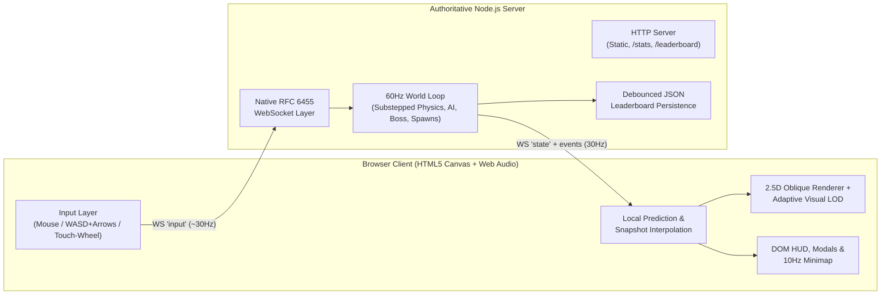

# HammerTime — Technical Design Document

## 1. Architecture Overview

HammerTime is a **zero-runtime-dependency TypeScript/Node.js** web application consisting of:

1. **Authoritative Multiplayer & Static HTTP Server (`src/server.ts`)**:
   - Serves static client assets, JSON endpoints (`/leaderboard.json`, `/stats/json`), and a built-in live telemetry HTML dashboard (`/stats`).
   - Implements a native **RFC 6455 WebSocket** upgrade and framing layer using Node's built-in `http` and `crypto` modules (no `ws`, `express`, or third-party runtime libraries).
   - Runs a single shared authoritative world simulation at **60 Hz** with substepped physics, broadcasting compacted world snapshots and discrete combat/audio events at **30 Hz**.
2. **Browser Client (`src/game.ts`, `index.html`, `style.css`)**:
   - Renders a custom **2.5D oblique projection** on a full-viewport HTML5 2D `<canvas>` plus a secondary minimap `<canvas>`.
   - Operates in **dual mode**:
     - **Multiplayer Mode** (default when served over HTTP/HTTPS): streams pointer/steering intent at up to ~30 Hz, runs local client-side prediction for the local warrior/hammers with smooth server reconciliation, and dead-reckons/interpolates remote players and enemies.
     - **Standalone Offline Fallback** (when opened via `file://` or when WebSocket is unavailable): runs a full local physics simulation loop mirroring server rules.
   - Synthesizes sound effects via the **Web Audio API** (with one embedded base64/MP3 sample for player hurt variations).

---

## 2. World Coordinate System & 2.5D Projection

- **Logical Simulation Plane**: A flat 2D square arena (`4200 × 4200` world units) containing 4 symmetrically placed, immovable circular stone columns around the center. All physics, collisions, distances, and AI operate strictly in undistorted 2D world space `(wx, wy)`.
- **Oblique Camera Mapping**: During rendering, world coordinates map to screen space via a vertical foreshortening factor (`TILT_Y ≈ 0.66`) and vertical elevation offset `wz`:
  - `screenX = wx - camX`
  - `screenY = (wy - camY) * TILT_Y - wz`
- **Inverse Screen-to-World Mapping**: Pointer screen coordinates convert cleanly back to world coordinates (`wx = camX + screenX`, `wy = camY + screenY / TILT_Y`) before sending to the physics loop or server.
- **Depth Ordering**: All volumetric 2.5D entities (columns, pickups, enemies, ghosts, laid-down motorcycle wrecks, warriors, hammers) are collected into a frame draw list, culled against the expanded camera frustum, and **Y-sorted** back-to-front before drawing.

---

## 3. Physics & Simulation Model

### Time Stepping & Substeps
- Frame/tick `dt` is clamped (max `50ms`) to prevent tunneling on stalls or tab switches.
- Each 60 Hz server tick (or client frame in standalone mode) is divided into **4 physics substeps** (stepping down to 2 under heavy server load) so fast-moving hammers and elastic chains remain stable.

### Warrior Kinematics & Input Translation
- All three input devices (pointer, keyboard, touch-wheel) normalize to a single `(mouseWorldX, mouseWorldY)` steering target so server physics handles every control method identically.
  - Keyboard mode rotates `warrior.angle` locally at a fixed angular rate and projects a virtual target ahead (short offset for turn-in-place, far offset when pressing forward).
  - Touch-wheel projects a virtual target offset around the warrior's screen position scaled by thumb deflection.
- **Movement Physics**:
  - Warriors turn toward the target angle (fast turn rate normally; restricted wide turning rate on a Motorcycle mount).
  - Forward thrust ramps via a `strideCharge` factor from walking to running speed, scaled by speed/traction multipliers and smooth arrival damping near the cursor.
  - Non-motorcycle warriors apply active reverse braking when current velocity opposes the target vector, enabling crisp whip reversals.
  - Exponential ground traction damping (`exp(-activeTraction * dt)`) governs stopping responsiveness; mounts override speed and traction multipliers (e.g., Tortoise has very high traction and low speed; Horse and Motorcycle have high speed).

### Chain & Warhammer Dynamics
- Each hammer is tethered by `N` links (`2` initial, up to `9` max; `N + 1` chain nodes from warrior to hammer head).
- **Position-Based Relaxation**:
  1. Endpoints `0` (warrior) and `N` (hammer) are pinned each substep; interior nodes integrate velocity.
  2. Over `K` relaxation iterations (`10` normal, `5` under load), segment distances are constrained toward rest segment length, interior nodes receive slight midpoint smoothing, and segments/nodes are projected outside nearby **stone columns** (allowing physical wrapping around pillars) and pushed off nearby enemies.
  3. Interior node velocities are reconstructed from position deltas blended with linear endpoint interpolation, and inward normal velocity against stone columns is zeroed.
- **Elastic Spring-Damper Tension**:
  - Total bent path length is summed across all segments. When it exceeds rest length (which scales up slightly during active Whirlwind), a Hookean spring force plus radial outward damping pulls the hammer inward along the final chain segment vector, and applies a capped counter-pull to the warrior along the first chain segment vector.
  - Hammer speed is capped to prevent numerical instability; the hammer itself experiences zero ground friction so it retains orbital energy.
  - When a player has 2 hammers, hammer heads perform pairwise elastic separation/clank collisions.

### Collision Detection & Broadphase Optimization
- **Broadphase AABBs**: Each player updates a reach bounding box encompassing their warrior body, all hammers, and all chain node extents; each hammer caches its chain bounding box. Enemy-vs-player checks reject immediately if AABBs do not overlap. Nearby columns and enemies for chain relaxation are pre-culled once per substep.
- **Hammer vs. Enemy**:
  - Circle-circle overlap resolution weighted by inverse mass (except attached boss segments, which stay anchored to the palm).
  - Semi-elastic impulse `J` computed along contact normal; damage is proportional to `J` with a short per-enemy hit cooldown to prevent multi-substep double hits.
  - **Special Hammer Interactions**:
    - *Disco*: skips damage/bounce and starts enemy dance state.
    - *Flame / Jack-o'-Lantern*: ignites enemy (Jack-o'-Lantern clears fireproof timer and refreshes burn); newly ignited non-boss zombies survive the initial hit with a small HP floor so they run around spreading fire.
    - *Spider*: applies 30s immobilization webbing to regular enemies or detached boss segments.
    - *Bomb / Thor*: triggers radial AoE explosion with distance falloff damage and outward impulse (Bomb consumes 1 charge; Thor triggers half-radius/half-damage lightning blast on every cooldown-eligible hit).
    - *Whirlwind*: discharges radial wind gust (or flaming gust) scaled by level 1–5 and resets charge.
- **Chain vs. Enemy**:
  - Continuous point-to-segment distance across all chain links against enemy circles.
  - Applies ~1/3 of equivalent hammer momentum and ~40% of equivalent hammer damage, distributing recoil proportionally along the chain lever arm between hammer and warrior.
- **Warrior vs. Enemy**:
  - *Bulldozer*: invulnerable, deals heavy crush damage + strong pushback on contact cooldown.
  - *Elephant*: pushes and tramples enemies for bonus contact damage while still taking enemy contact hits against mount HP.
  - *Standard / Other Mounts*: mutual body separation; awake/active enemies deal contact damage on a cooldown (absorbed by `mountHp` first before warrior `hp`). Knocked-down, dancing, and webbed enemies cannot deal contact damage.
- **Enemy vs. Enemy**: Soft pairwise separation (stationary fallen/webbed/dancing enemies are not pushed around) plus **contact contagion** for Fire, Fear, and Disco Dance states.

---

## 4. Entity State Machines & AI

### Regular & Milestone Zombies
- **Targeting**: Pursue the nearest alive player, unless overridden by status states in priority order:
  1. *Knocked Down* (earthquake + recovery): completely motionless.
  2. *Webbed* (spider): motionless (rapidly damped if struck).
  3. *Dancing* (disco): motionless in place; transitions to 45s dance-immune on expiry.
  4. *Headless* (lost `'head'` limb): wanders in circles, reflecting off arena walls.
  5. *Feared*: flees at 4x speed either toward the nearest map edge (boss spawn panic) or away from the fear source with border-slide deflection to avoid corner trapping.
- **Armored Mobs**: Share a `mobId`; each step computes the group centroid and blends 65% player-pursuit vector with 35% cohesion toward the centroid.
- **Motorcycle Zombies**: Steer using an angular turn-rate limit rather than instant heading snaps, creating sweeping arcs. Dropping below 50% HP (or dying) triggers a dismount/crash event that converts the zombie to a standard walker and spawns a timed `LaidDownMotorcycle` wreck.

### Boss Hand State Machine
- Tracked in an `activeBossHands` map linking 1 `palm` entity and 14 `segment` entities (5 digits: `[2, 3, 3, 3, 3]`) stored in the shared `enemies` array.
- **Attached Kinematics**: Every substep, the palm advances toward the nearest warrior and oscillates a `fingerSpreadPhase`; all attached segments lock deterministically to articulated polar poses radiating from the palm.
- **Damage Routing**: `resolveBossTargetSegment()` redirects any hit on the palm or an attached digit to the highest `segmentIndex` still attached on that digit (or highest remaining attached segment overall).
- **Detachment**: When a segment reaches `≤ 25%` HP, `attached = false`, it pops outward, and independently chases players at higher speed.
- **Defeat Sequence**: Once 14 segments are destroyed, all boss parts freeze and blink for 3 seconds while spawning 24 powerups in inner/outer rings, then trigger an earthquake and clean up all boss entities.

### Solo Companion Bot AI
- Spawned server-side only when `humanPlayers === 1` and active bots `< 1` at 30-kill intervals.
- Strictly timer-based 6-second cycle across three states:
  - `aggressive`: orbits the nearest enemy at chain rest-length distance using radial error correction plus a tangential sweep vector to keep the hammer whipping.
  - `evasive`: sums repulsive vectors from nearby enemies, stone columns, and arena margins.
  - `greedy`: steers directly toward the nearest pickup token.

---

## 5. Networking Protocol & Client Prediction

### Native WebSocket Framing
- Server handles `HTTP/1.1 101 Switching Protocols` upgrade with SHA-1 `Sec-WebSocket-Accept`, disables Nagle (`socket.setNoDelay(true)`), decodes masked client frames (7-bit, 16-bit, 64-bit lengths, ping/pong, close), and encodes unmasked JSON text frames.

### Message Schema
- **Client → Server**:
  - `set_nickname`: `{ type, nickname, leaderboard? }` sent on connect to claim identity and merge offline leaderboard scores.
  - `input`: `{ type, nickname?, active, mouseWorldX, mouseWorldY }` throttled to ~30 Hz (or 250ms heartbeat when stationary).
  - `cheat` / `boss_cheat` / `reset`: trigger debug/round actions.
- **Server → Client**:
  - `welcome`: `{ type, playerId, leaderboard }` sent immediately upon upgrade, followed by an initial `state` snapshot.
  - `state` (30 Hz): `{ type, roundState, teamKills, earthquakeTimer, victoryInfo, players[], enemies[], pickups[], events[], leaderboard[], roundRestartTimer }`. Numeric fields are rounded to 1–3 decimals to keep JSON payloads compact.
  - `events[]` (flushed per broadcast): discrete one-shot cues (`impact`, `enemy_die`, `limb_loss`, `pickup`, `explosion`, `player_hurt`, `ignite`, `earthquake`, `boss_spawn`, `boss_defeated`, `fear_wave`, `fear_taint`, `bulldozer`, `disco_pickup`, `disco_dance`, `jackolantern_pickup`, `spider_pickup`, `spider_web`, `thor_pickup`, `shockwave`, `motorcycle_wreck`, `claim_motorcycle`, `mount_gain`, `mount_lost`, `player_join`, `player_die`, `floating_text`, `victory`, `cheat`, `round_reset`).
  - `idle_disconnect`: `{ type, reason }` sent before closing an idle socket.

### Client-Side Prediction & Interpolation
- **Local Warrior & Hammers**: The client runs local physics prediction every `requestAnimationFrame` for zero-latency steering feel. When server snapshots arrive, it soft-blends positions/velocities (~12% per snapshot + continuous exponential blend toward extrapolated server targets) and hard-snaps only on spawn, respawn, round reset, or divergence `> 260px`.
- **Remote Players & Enemies**: Dead-reckoned forward each frame using latest velocity and exponentially interpolated toward incoming server positions and angles (`lerpAngle`).
- **Auto-Reconnect**: Unexpected WebSocket closes schedule a reconnect attempt after 2 seconds while the player remains in-game.

---

## 6. Adaptive Performance & Resource Management

### Server Adaptive Fidelity
- Tracks an exponential moving average of physics tick execution time (`avgTickMs`).
- If rolling tick time exceeds ~60% of the 16.7ms frame budget (`> 10ms`), steps down to reduced fidelity (`2` physics substeps, `5` chain relaxation iterations).
- Restores full fidelity (`4` substeps, `10` relaxation iterations) with hysteresis once `avgTickMs < 6.5ms`.
- When zero players are connected, the tick loop returns immediately (near-zero CPU) and tracks `lastEmptyTime` for clean resets after idle gaps.

### Client Dynamic Visual LOD (3 Tiers: High / Medium / Low)
- Monitors rolling frame delta (`avgFrameMs`) with hysteresis thresholds (`19.5ms` → Medium, `26ms` → Low; recovers at `22.5ms` / `17.5ms`).
- Scales dynamically per tier:
  - Max particles (`420` / `200` / `90`) and spawn multiplier (`1.0` / `0.5` / `0.25`).
  - Max floating text labels (`64` / `32` / `16`).
  - Max concurrent sound effects per 100ms window (`6` / `4` / `2`) and metallic overtone oscillators (disabled on Low).
  - Non-whirlwind hammer motion trails, particle drop shadows, secondary chain link torus highlights, and offscreen event culling margins.
- **Additional Client Optimizations**:
  - Minimap refreshes at **10 Hz** instead of 60 Hz.
  - DOM HUD updates use dirty-checking (`setTextIfChanged`, `setStyleIfChanged`) and leaderboard signature hashing to avoid unnecessary layout/reflow churn.
  - Ground grass tufts and field pebbles are batched into minimal `stroke()` / `fill()` draw calls.
  - Device pixel ratio is clamped to `<= 2`.

---

## 7. Persistence, Telemetry & Deployment

### Leaderboard Persistence
- Stored as formatted JSON (`{ updatedAt, entries[] }`) at `LEADERBOARD_FILE` (default `./leaderboard.json`).
- Uses a case-insensitive nickname key, preserving each player's personal best kill count.
- Disk writes are debounced (~10 seconds) and performed asynchronously via `fs.promises` during runtime, with synchronous flush on `SIGINT`/`SIGTERM` graceful shutdown.

### Built-In Server Telemetry (`/stats`)
- Records per-second rolling history (up to 120 seconds) of connected players, alive players, HTTP requests/sec, average HTTP latency, and WebSocket messages/sec.
- Exposed via `/stats/json` and rendered as a self-contained dark-mode HTML dashboard with live `<canvas>` sparkline charts at `/stats` (automatically pausing polling when the tab is hidden or idle).

### Cloud Deployment Architecture
- **Split Static + Compute Topology** (cost-optimized for scale-to-zero):
  - **App Engine (`app.yaml`)**: Serves static HTML, CSS, compiled JS, and MP3s with zero compute instances.
  - **Cloud Run (`Dockerfile`)**: Builds TypeScript inside `node:22-alpine`, runs `node dist/server.js` on port `8080`, configured with `min-instances: 0`, `max-instances: 1` (single shared authoritative arena), 60-minute WebSocket timeout, and a mounted Cloud Storage bucket (`/data/leaderboard.json`) for durable leaderboard storage.
  - Client auto-detects `.appspot.com` hosts and routes WebSocket connections to the Cloud Run `wss://` endpoint (with `window.HAMMERTIME_WS_URL` override support for local/custom environments).

---

## 8. Testing Strategy

- Uses a lightweight, zero-dependency custom test harness (`test/harness.js`, `test/run.js`) executed via `npm run test` (`tsc && node test/run.js`).
- **Server Suite (`test/server.test.js`)**: Imports exported simulation internals and HTTP/WS helpers from `dist/server.js` to unit-test physics invariants, chain wrapping, all powerups, enemy waves, boss segment routing/detachment, bot AI, leaderboard persistence, idle pruning, adaptive fidelity, and `/stats` telemetry.
- **Client Suite (`test/client.test.js`)**: Runs `dist/game.js` inside a Node VM/mocked browser environment (mock `window`, `document`, `CanvasRenderingContext2D`, `AudioContext`, `WebSocket`) via the `window.__HAMMERTIME_TEST__` hook to verify input handling, prediction/reconciliation, camera deadzone, HUD updates, procedural rendering paths, adaptive LOD, and audio triggers.
